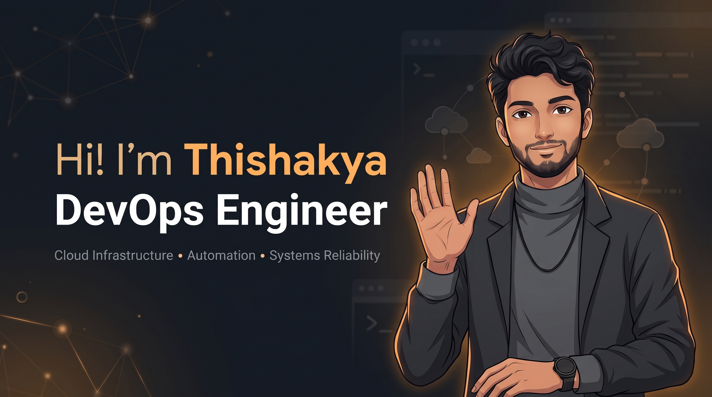

  

   

  <!-- Animated Typing Subtitle -->
  

   

  <!-- Badges Ribbon -->
  
  &nbsp;
  
  &nbsp;
  
  &nbsp;
  

 

---

### Activity & Performance

  <!-- Overview Stats & Top Languages -->
  

    
    &nbsp;
    
  

  <!-- Streak Stats (Crisp native proportions) -->
  

    
  

  <!-- Activity Frequency Graph (Active Working Mirror) -->
  

    
  

---

### Contribution Stream

  <picture>
    <source media="(prefers-color-scheme: dark)" srcset="https://raw.githubusercontent.com/thishakyawmh/thishakyawmh/output/github-contribution-grid-snake-dark.svg">
    <source media="(prefers-color-scheme: light)" srcset="https://raw.githubusercontent.com/thishakyawmh/thishakyawmh/output/github-contribution-grid-snake.svg">
    
  </picture>

---

### Technical Capabilities

| Domain | Stack & Tooling Chips |
| :--- | :--- |
| **DevOps & Cloud** |       |
| **Languages** |      |
| **Web & Mobile** |     |
| **Data & Hardware** |   |
| **Design & Prototyping** |   |

---

### Core Focus & Capabilities

<table>
  <tr>
    <td width="50%" valign="top">
      <h4>DevOps & Cloud Systems</h4>
      
Designing automated CI/CD pipelines, container orchestration, and resilient cloud environments.

      
      
      
      
      
    </td>
    <td width="50%" valign="top">
      <h4>Education & Mentorship</h4>
      
Delivering structured ICT tutoring sessions and guiding students in computing fundamentals.

      
      
      
      
    </td>
  </tr>
  <tr>
    <td width="50%" valign="top">
      <h4>Technical Writing & Media</h4>
      
Authoring in-depth engineering breakdowns on systems administration, tools, and workflows.

      
      
      
      
    </td>
    <td width="50%" valign="top">
      <h4>Software Engineering</h4>
      
Building full-stack web and mobile applications with focus on clean code and reliable architecture.

      
      
      
      
    </td>
  </tr>
</table>

---

### Engineering Lifecycle

<table>
  <tr>
    <td width="50%" valign="top">
      <h4>1. Code & Version Control</h4>
      
Clean commit history, branching strategies, and codebase governance.

      
      
      
    </td>
    <td width="50%" valign="top">
      <h4>2. CI & Automated Testing</h4>
      
Automated validation, linting, and quality gates on every push.

      
      
      
    </td>
  </tr>
  <tr>
    <td width="50%" valign="top">
      <h4>3. Containerization</h4>
      
Immutable, reproducible container builds and isolated services.

      
      
      
    </td>
    <td width="50%" valign="top">
      <h4>4. Cloud & Continuous Deployment</h4>
      
Continuous cloud delivery, server monitoring, and production workloads.

      
      
      
    </td>
  </tr>
</table>

---

### Connect & Networks

| Channel | Profiles & Links |
| :--- | :--- |
| **Professional** |      |
| **Developer Ecosystem** |     |
| **Problem Solving** |       |
| **Creative Design** |   |

---

### Support

  
  &nbsp;&nbsp;
  

 
