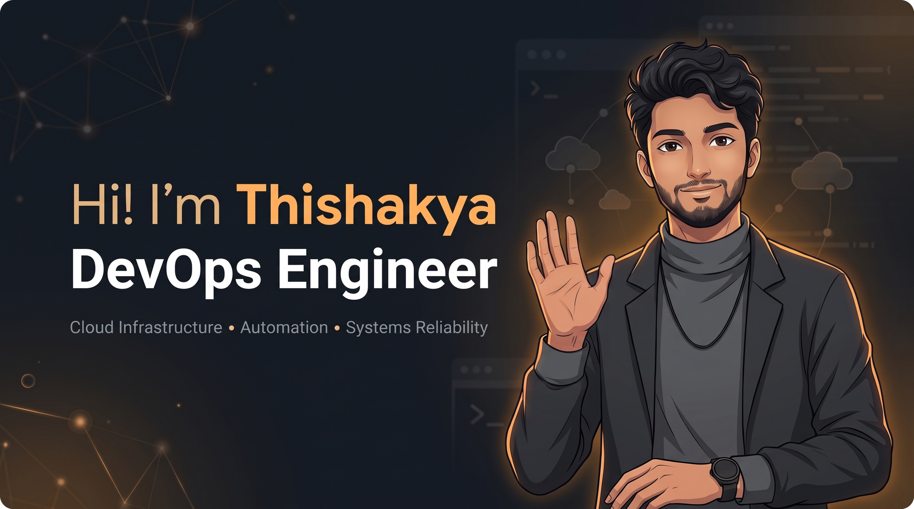

  

  <h1>Hi, I'm Hirun Thishakya 👋</h1>
  
<strong>Computing & Information Systems Undergraduate</strong>

  
Aspiring DevOps & Cloud Engineer · Full-Stack Developer · ICT Tutor

  <a href="https://www.thishakya.com/">Portfolio</a> ·
  <a href="https://linkedin.com/in/thishakya">LinkedIn</a> ·
  <a href="mailto:hirunthishakya.wmh25@gmail.com">Email</a>

---

## About me

I'm an undergraduate in BSc (Hons) Computing & Information Systems at Sabaragamuwa University of Sri Lanka. My main career focus is **DevOps and Cloud Engineering**, while I continue building full-stack web and mobile applications.

I enjoy learning by building practical projects, documenting what I learn, and helping students understand ICT and programming concepts.

## Current focus

- Linux system administration, Bash scripting, SSH, networking, and Nginx
- Docker, Docker Compose, container security, and CI/CD with GitHub Actions
- Cloud deployment, environment configuration, monitoring, and application reliability
- Building maintainable APIs and full-stack applications

## Technologies

| Area | Tools and technologies |
|---|---|
| DevOps & systems | Linux, Bash, Git, Docker, Docker Compose, GitHub Actions, Nginx, SSH |
| Cloud & deployment | Azure services, Vercel, Supabase, Neon, Upstash |
| Web & backend | React, Next.js, TypeScript, JavaScript, Node.js, Express, Laravel, PHP |
| Mobile | React Native, Expo |
| Databases | PostgreSQL, MySQL, MongoDB, Redis |
| Programming | Python, Java, C, SQL |

*I distinguish tools I've used in projects from technologies I'm still developing deeper production experience with.*

## Selected projects

### DevOps, cloud & systems

- **[Dockerized Web Application](https://github.com/thishakyawmh/dockerized-web-application)** — Flask and Redis services with Docker Compose, health checks, persistent storage, and GitHub Actions CI/CD
- **[Linux Server Administration Lab](https://github.com/thishakyawmh/linux-server-administration-lab)** — Ubuntu administration notes and practical Bash/Nginx deployment, backup, health-check, and recovery scripts
- **[Kinetic HR Cloud](https://github.com/thishakyawmh/Kinetic-HR-Cloud)** — Multi-tenant HR platform exploring cloud-backed services and enterprise application architecture

### Software engineering

- **[CODL-SUSL](https://github.com/thishakyawmh/CODL-SUSL)** — University management and analytics platform built with React, TypeScript, and Laravel
- **[Spendly](https://github.com/thishakyawmh/spendly)** — Expense tracking application using React Native, Clerk, Express, Neon PostgreSQL, and Upstash
- **[I-Computers](https://github.com/thishakyawmh/i-computers-frontend)** — E-commerce frontend and backend with React, Express, MongoDB, and JWT authentication
- **[AssetSync](https://github.com/thishakyawmh/AssetSync_Frontend)** — University equipment and room resource allocation application

## Learning and certifications

- Git Essential Training
- Networking Foundations
- Learning Linux Command Line
- DevOps Foundations

## Teaching

I have experience tutoring ICT for Grade 8–9, O/L, and A/L students in Sinhala and English medium. I enjoy making technical topics simple through notes, examples, and practical exercises.

## GitHub activity

  
  

  

---

  
Always learning. Always building. Always improving.

